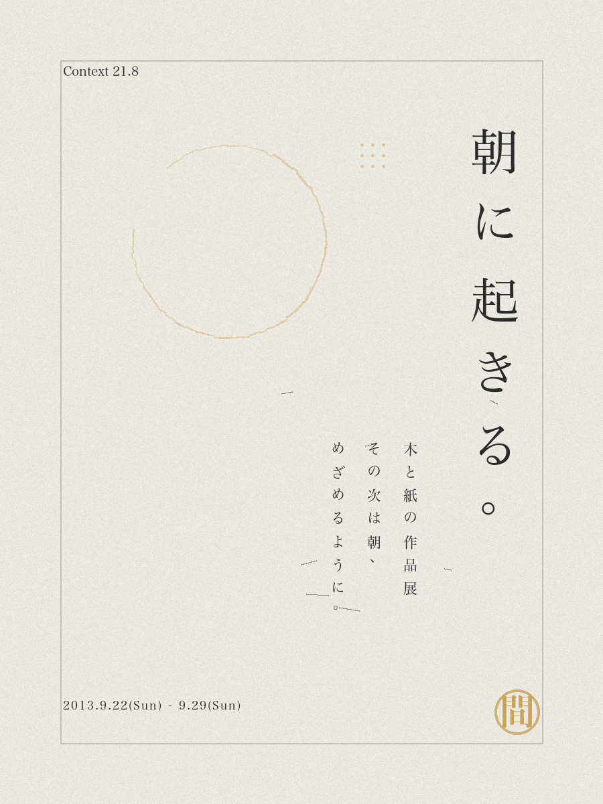
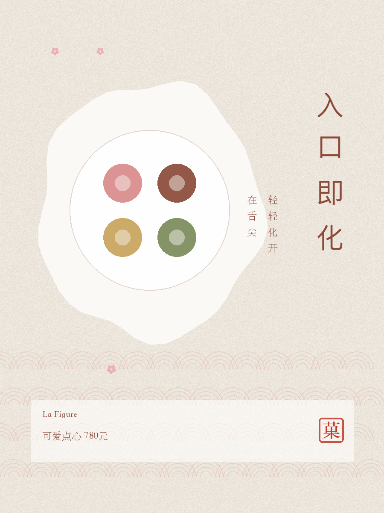

# 日式海报生成器 / Japanese Poster Generator

一个 [WorkBuddy](https://www.workbuddy.cn/) Skill：一句话主题即可生成日式风格海报，也可作为独立 Python 脚本调用。内置 5 种版式，输出高清 PNG；**文案跟随用户原文，不强制翻译成日文**。

## 效果预览

| 极简留白 (A) | 和食美食 (C) | 手绘诗意 (E) |
| :---: | :---: | :---: |
|  |  |  |

## 功能

- **5 种版式**：极简留白、传统纹样、和食/和菓子美食、前卫排版、手绘诗意。
- **日式视觉语法**：竖排文字、和纸肌理、朱印、传统纹样（樱花、青海波、麻叶、圆相、扇形等）。
- **语言规则**：中文输入出中文海报，英文输入出英文海报；"日式"只体现在视觉，不翻译文案。
- **可复现**：固定 `seed` 时，相同配置总能得到相同海报。
- **可扩展**：支持合成真实照片（`--image`），也支持先用 AI 生成无文字背景、再由脚本排版。

## 安装到 WorkBuddy

```bash
git clone https://github.com/hu4er/japanese-poster-skill.git ~/.workbuddy/skills/japanese-poster
```

重启 WorkBuddy 后，用「生成一张日式海报」「做一个极简留白风格的展览海报」这类指令即可触发。若 `~/.workbuddy/skills/japanese-poster` 已存在，先移除旧目录再克隆。

## 命令行用法

依赖 Python 3 与 Pillow：

```bash
pip3 install Pillow
python3 scripts/generate.py --preset A --title "花与纸" --subtitle "春日小展" --footer "2026.04" --out poster.png
```

也可以用 JSON 完整控制：

```json
{
  "archetype": "C",
  "title": "入口即化",
  "subtitle": "和菓子",
  "bg": "#F5F1E8",
  "accent": "#B23A2B",
  "seed": 42
}
```

```bash
python3 scripts/jp_poster.py --config spec.json --out poster.png
```

完整字段（`title`、`subtitle`、`body`、`footer`、`size`、`bg`、`accent`、`image`、`seed`、字体等）见 [SKILL.md](SKILL.md)，配色与版式细则见 [references/style-guide.md](references/style-guide.md)。

## 版式速查

| 代号 | 版式 | 适用场景 |
| :---: | --- | --- |
| A | 极简留白 Minimal Ma | 展览、诗歌、禅意主题 |
| B | 传统纹样 Traditional | 店铺、品牌、节庆 |
| C | 和食/和菓子美食 Food | 餐饮、美食、甜品 |
| D | 前卫排版 Avant-garde | 戏剧、设计宣言、活动 |
| E | 手绘诗意 Hand-drawn | 艺术、音乐、情感日常 |

## 目录结构

```
.
├── SKILL.md                  # Skill 定义与触发规则
├── references/
│   └── style-guide.md        # 5 种版式的完整风格语法
├── scripts/
│   ├── generate.py           # 便捷入口，自动定位 jp_poster.py
│   └── jp_poster.py          # 海报生成引擎
└── examples/                 # 效果示例
```

## 说明

本仓库未附加开源协议，仅供个人学习与使用。海报生成脚本依赖 macOS 系统字体；其他平台会自动回退到默认字体，排版效果可能略有差异。
